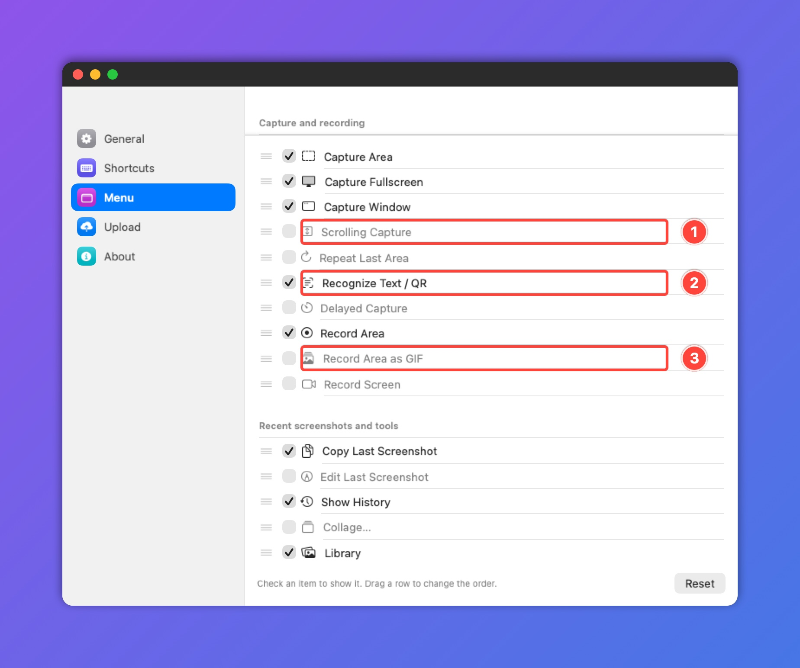

# Kadr

**Free screenshot & screen recording app for macOS.** A free replacement for paid screenshot tools —
every feature, no limits, no account, no telemetry.

[English](#install) · [Українською](#українською) · [По-русски](#по-русски)



<sub>This image was made with Kadr: numbered markers, frames, window chrome and gradient backdrop.</sub>

## Install

**Easiest — one command, about a minute:**

1. Open **Terminal**: press **⌘ Space**, type `Terminal`, press **Enter**.
2. Paste this line (**⌘ V**) and press **Enter**:

   ```
   curl -fsSL https://raw.githubusercontent.com/inkstatim/kadr-releases/main/install.sh | bash
   ```

3. Done — Kadr downloads, installs to Applications and starts. Its icon appears in the menu bar.

**Homebrew:**

```
brew install inkstatim/kadr/kadr
```

**Or download the DMG:** [Kadr.dmg](https://github.com/inkstatim/kadr-releases/releases/latest/download/Kadr.dmg) →
drag Kadr to Applications. On first launch macOS warns that it can't verify the developer: open
**System Settings → Privacy & Security → Open Anyway** (macOS 14: right-click Kadr → Open).

On first launch Kadr asks for **Screen Recording** permission — screenshots don't work without it.
Kadr opens the right setting for you. macOS 14 or later, Apple Silicon and Intel.

## Features

- Capture an area, a window (with shadow) or the full screen; **⌘⇧4 / ⌘⇧3** like macOS, with a preview in the corner
- Editor: arrows, shapes, text, numbered markers, highlighter, blur, pixelate, spotlight, magnifier, color picker, crop, resize
- Backdrop: gradients and window, browser, MacBook and iPhone frames; auto-hide e-mails, phones, card numbers and tokens
- Scrolling screenshots
- Text and QR recognition (OCR)
- Screen recording to MP4 or GIF, with system audio and microphone (microphone on macOS 15+)
- History, library with search by text inside screenshots, collages, pin a screenshot on top of all windows
- Upload to S3 / Cloudflare R2 / your server with the link copied to the clipboard
- 14 interface languages: English, Deutsch, Español, Français, Italiano, Nederlands, Polski, Português (Brasil), Türkçe, Українська, Русский, 日本語, 한국어, 简体中文 — follows your system language, switch any time in Settings

## Privacy & safety

- Screenshots never leave your Mac unless you upload them yourself. No account, no analytics.
  Kadr goes online only to check this repository for updates (once a day).
- Kadr is not notarized by Apple: that needs a paid developer certificate ($99/year).
  It is signed with its own certificate; the installer checks that signature before installing.
  The installer is a short script — [read it](install.sh) before running.

## ☕ Buy me a coffee

Kadr is free. If it saves you time, you can buy the developer a coffee in crypto.
**Send only on the network shown** — a transfer on another network is lost.

| Coin | Network | Address |
|---|---|---|
| USDT | TRC-20 (Tron) | `TAWB59Ux6Zbtn1cgG5DhSXXYnP8xpYSW2U` |
| SOL | Solana | `8kn2UnorPSzKVNiDXSsUhLQxcN9PzBrGGC2CYD9oNswQ` |
| BTC | Bitcoin | `16eZYwKBSFA6bgRodD2qTMK3KBtUdwXooJ` |

Ideas, bugs, feature requests — Telegram [@akm_tims](https://t.me/akm_tims).

---

## Українською

**Kadr — безкоштовна програма для знімків і запису екрана на macOS.** Безкоштовна заміна платним
скриншотерам: усі функції без обмежень, без акаунта й аналітики. Інтерфейс українською.

**Встановлення за хвилину:** відкрийте «Термінал» (**⌘ Пробіл** → `Термінал` → **Enter**), вставте рядок і натисніть **Enter**:

```
curl -fsSL https://raw.githubusercontent.com/inkstatim/kadr-releases/main/install.sh | bash
```

Kadr сам завантажиться, встановиться в «Програми» й запуститься. Також: `brew install inkstatim/kadr/kadr`
або [Kadr.dmg](https://github.com/inkstatim/kadr-releases/releases/latest/download/Kadr.dmg)
(тоді при першому запуску: «Системні параметри» → «Приватність і безпека» → «Усе одно відкрити»).

Що вміє: знімки області, вікна й екрана, ⌘⇧4 / ⌘⇧3 як у macOS, редактор зі стрілками, текстом,
розмиттям і лічильниками, оформлення з градієнтами й рамками, скрол-скриншоти, розпізнавання тексту
й QR, запис екрана в MP4/GIF, бібліотека з пошуком, колажі, завантаження в S3/R2.

**На каву ☕** — якщо Kadr знадобився, адреси вище, у розділі [Buy me a coffee](#-buy-me-a-coffee).
Ідеї та помилки — у Telegram [@akm_tims](https://t.me/akm_tims).

## По-русски

**Kadr — бесплатное приложение для скриншотов и записи экрана на macOS.** Бесплатная замена платным
скриншотерам: все функции без ограничений, без аккаунта и аналитики.

**Установка за минуту:** откройте «Терминал» (**⌘ Пробел** → `Терминал` → **Enter**), вставьте строку и нажмите **Enter**:

```
curl -fsSL https://raw.githubusercontent.com/inkstatim/kadr-releases/main/install.sh | bash
```

Kadr сам скачается, установится в «Программы» и запустится. Ещё варианты: `brew install inkstatim/kadr/kadr`
или [Kadr.dmg](https://github.com/inkstatim/kadr-releases/releases/latest/download/Kadr.dmg)
(тогда при первом запуске: «Системные настройки» → «Конфиденциальность и безопасность» → «Всё равно открыть»).

**На кофе ☕** — если Kadr пригодился, адреса выше, в разделе [Buy me a coffee](#-buy-me-a-coffee).
Идеи и ошибки — в Telegram [@akm_tims](https://t.me/akm_tims).

---

## For the maintainer (по-русски)

`appcast.json` — манифест обновлений: Kadr раз в сутки и по «Проверить обновления…» читает его
с `raw.githubusercontent.com` и предлагает скачать новую версию, если `build` больше установленного.
Ссылка `url` должна вести в этот репозиторий — другие адреса приложение не откроет.

`install.sh` — установка одной командой: скачивает `releases/latest/download/Kadr.dmg`, проверяет подпись,
копирует Kadr в «Программы» и запускает. Файл, скачанный через `curl`, не получает карантин,
поэтому Gatekeeper не спрашивает про неизвестного разработчика.

Выпуск версии: `scripts/release.sh` делает `Kadr-<версия>.dmg` и его копию `Kadr.dmg` → новый релиз здесь
(тег `v<версия>`, **оба** DMG во вложении), затем поднять `version`, `build`, `url` и `notes` в `appcast.json`.
`Kadr.dmg` с постоянным именем нужен для `install.sh` и прямой ссылки на скачивание.
